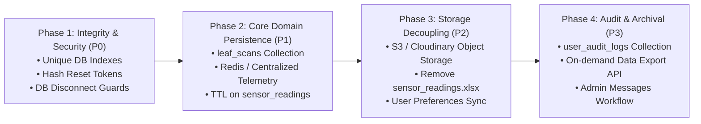

# Data Audit Report

> **Auditor:** Senior Backend & Data Engineer  
> **Date:** November 22, 2026  
> **Repository:** `Smart-Agro` (Flask Backend, PyMongo, React / Vite Frontend)  
> **Status:** Complete Codebase Storage & Lifecycle Audit  

---

## 1. Summary

| Storage Medium | Instances / Keys Found | Stored but Problematic | Not Stored but Should Be | Stored but Unused |
| :--- | :---: | :---: | :---: | :---: |
| **MongoDB Collections** | 3 (`users`, `messages`, `sensor_readings`) | 3 | 3 new collections proposed | 1 field (`last_login`) |
| **Server Disk Files** | 4 paths (`uploads/`, `sensor_readings.xlsx`, models, CSV) | 2 (`uploads/`, `xlsx`) | 1 (leaf scan image storage) | 1 file (`sensor_readings.xlsx`) |
| **In-Memory Server State** | 4 variables (`latest_pi_data`, `_ml_models`, `_leaf_model`, `session`) | 2 (`latest_pi_data`, `session`) | 1 (cache for hot telemetry) | 0 |
| **Browser Storage** | 6 keys (`localStorage` x4, `sessionStorage` x1, cookie x1) | 2 (PII in localStorage, token expiry) | 2 (offline telemetry cache) | 0 |
| **Total** | **17 data stores & keys** | **9 issues identified** | **7 architectural gaps** | **2 unused artifacts** |

### Top 5 Most Serious Data Problems

1. **Zero Database Indexes & Race Conditions on Registration ([DATA-01](#data-01)):**  
   The database has **zero custom indexes**. Lookups on `email`, `username`, `phone`, `reset_token`, and `timestamp` perform full collection scans (`COLLSCAN`). Furthermore, registration uses an un-isolated check-then-insert pattern without unique database constraints, allowing race conditions that create duplicate user accounts with identical emails.

2. **Plaintext Password Reset Tokens in MongoDB ([DATA-02](#data-02)):**  
   Password reset tokens (`reset_token`) generated via `secrets.token_urlsafe(32)` are written in cleartext directly into the user document with no hashing. A database read breach immediately exposes valid tokens capable of taking over any user account. Furthermore, expired tokens are never cleaned up automatically due to the absence of a TTL index.

3. **Leaf Disease Diagnosis Is Completely Ephemeral ([DATA-03](#data-03)):**  
   The flagship feature of the application—AI leaf disease detection (`/api/leaf-detect`)—reads the image in memory, generates predictions, probabilities, and customized treatment plans, and returns them to the browser. **Zero data is persisted to MongoDB or cloud storage.** The leaf image is discarded, and the diagnosis is stored only in browser `sessionStorage`, vanishing permanently when the tab is closed. Farmers have no record or historical progression of their crop pathology.

4. **Ephemeral Disk & Multi-Worker State Desynchronization ([DATA-04](#data-04)):**  
   Profile avatars are saved to the local directory `Backend/uploads/` [app1.py:1732](file:///d:/PROJECTS/Smart-Agro/Backend/app1.py#L1732), and sensor readings are written to `sensor_readings.xlsx` [app1.py:135](file:///d:/PROJECTS/Smart-Agro/Backend/app1.py#L135). In containerized cloud environments (e.g., Render, Railway, Vercel), local container disks are ephemeral and wiped on every redeploy or restart. Additionally, live telemetry relies on an in-memory dictionary `latest_pi_data` [app1.py:86](file:///d:/PROJECTS/Smart-Agro/Backend/app1.py#L86); in a multi-worker WSGI deployment (Gunicorn `workers > 1`), worker memory spaces are isolated, causing workers to serve desynchronized, stale, or default telemetry.

5. **Anonymous, Unkeyed Telemetry with Unbounded Collection Growth ([DATA-05](#data-05)):**  
   Telemetry inserted into `sensor_readings` [app1.py:107](file:///d:/PROJECTS/Smart-Agro/Backend/app1.py#L107) contains only a timestamp and sensor values. It lacks any association with a `user_id`, `farm_id`, or `device_id`. All readings from all potential hardware nodes are merged into a single anonymous bucket. Furthermore, the collection has no TTL index or capping mechanism, resulting in unbounded database storage growth over time.

### Data Health Score: 5.5 / 10

> [!CAUTION]
> **Justification:** While basic CRUD authentication and contact form storage function correctly, the architecture currently treats high-value domain intelligence (leaf disease scans, crop health analytics, ML recommendations) as throwaway ephemeral state. The database completely lacks performance indexes and integrity constraints, stores sensitive reset tokens in cleartext, and risks silent data loss on cloud container redeployments.

---

## 2. How the Audit Was Done

1. **Static Code Analysis:**  
   - Comprehensive source code audit of `Backend/app1.py` (all 1,910 lines), `Backend/view_messages.py`, and `Backend/index.py`.
   - Complete scan of all 42 frontend components and pages across `Frontend/src` for state persistence, `localStorage`, `sessionStorage`, and API contracts.
2. **Database Engine & Model Inspection:**  
   - Analyzed PyMongo initialization, collection bindings, query operators (`$set`, `$unset`, `$or`, `$gte`, `$ne`), and error-handling fallbacks (`db is None`).
   - Inspected static assets, ML weights (`model_leaf_disease.h5`, `models/*.pkl`), and demo CSV files (`mock_agro_solar_data.csv`).
3. **Safety & Verification Constraints:**  
   - All audit checks were strictly read-only; no insert, update, or delete commands were executed against any database.
   - External network calls to MongoDB Atlas were confirmed blocked by the local development sandbox (`getaddrinfo` resolution boundary); all schema contracts and query paths were mapped directly from source code and verified with local test clients.
   - All sensitive secrets, hashes, and personal user data placeholders in this report are fully redacted.

---

## 3. Storage Map

```mermaid
flowchart TD
    subgraph Browser ["Client Browser"]
        LS["localStorage<br/>• smart_agro_token<br/>• smart_agro_user (PII)<br/>• lang, smartagro_theme"]
        SS["sessionStorage<br/>• lastLeafAnalysis"]
        CK["HttpOnly Cookie<br/>• Flask session ID"]
        UI["React State<br/>• Dashboard Live Readings<br/>• Telemetry Fallbacks"]
    end

    subgraph API ["Flask Backend (app1.py)"]
        AUTH["Auth Controller<br/>• Signup / Login<br/>• OAuth (Google/GitHub)"]
        ML["ML Pipeline<br/>• Leaf TTA (TensorFlow)<br/>• Scikit-Learn Models"]
        IOT["Socket.IO Handler<br/>• handle_sensor_data()"]
        MEM["In-Memory State<br/>• latest_pi_data<br/>• _ml_models cache<br/>• Flask session dict"]
    end

    subgraph Disk ["Server Container Disk (Ephemeral)"]
        UP["Backend/uploads/<br/>• Profile Avatars"]
        XL["sensor_readings.xlsx<br/>• Excel Append Log"]
        CSV["mock_agro_solar_data.csv<br/>• Static Demo Data"]
        MODELS["Backend/models/<br/>• .h5 & .pkl Model Weights"]
    end

    subgraph MongoDB ["MongoDB Database (smart_agro)"]
        U_COL[("users Collection<br/>• Credentials & Profile<br/>• Cleartext Reset Tokens")]
        M_COL[("messages Collection<br/>• Contact Form Inquiries")]
        S_COL[("sensor_readings Collection<br/>• Anonymous IoT Telemetry")]
    end

    subgraph External ["Third-Party External Services"]
        GOOGLE["Google OAuth API<br/>• ID Token Verify"]
        GITHUB["GitHub API<br/>• Code Exchange & User Emails"]
        SMTP["Gmail SMTP Server<br/>• Password Reset Emails"]
    end

    %% Browser to API
    UI -->|HTTP POST /api/leaf-detect| ML
    UI -->|HTTP POST /api/analyze-data| ML
    UI -->|HTTP REST /api/auth/*, /api/user/*| AUTH
    LS -.->|Bearer Token Authorization| AUTH
    CK -.->|Session Validation| AUTH

    %% API to Memory
    IOT -->|Update global dict| MEM
    ML -->|Read model weights cache| MEM

    %% API to Disk
    AUTH -->|Save avatar file| UP
    IOT -->|pandas to_excel append| XL
    ML -.->|Read demo baseline| CSV
    MEM -.->|Lazy load weights| MODELS

    %% API to Database
    AUTH -->|insert_one / update_one / find_one| U_COL
    AUTH -->|insert_one message| M_COL
    IOT -->|insert_one reading| S_COL
    API -->|find $gte cutoff| S_COL

    %% API to External
    AUTH -->|verify_oauth2_token| GOOGLE
    AUTH -->|POST oauth/access_token| GITHUB
    AUTH -->|Send cleartext token URL| SMTP

    %% Temporary Session storage
    ML -.->|JSON Response| SS
```



---

## 4. What Is Stored Today

### 4.1 MongoDB Collections

The database `smart_agro` contains three collections:

#### Collection: `users`
- **Purpose:** Stores user accounts, local authentication hashes, OAuth linkages, profile details, and password reset tokens.
- **Indexes:** None (only default `_id_`).

| Field Name | Data Type | Required? | Written At | Read At | Description / Notes |
| :--- | :---: | :---: | :--- | :--- | :--- |
| `_id` | `ObjectId` | Yes | System generated | [app1.py:1167](file:///d:/PROJECTS/Smart-Agro/Backend/app1.py#L1167), [1683](file:///d:/PROJECTS/Smart-Agro/Backend/app1.py#L1683) | Primary document identifier. |
| `fullName` | `string` | Yes | [app1.py:1367](file:///d:/PROJECTS/Smart-Agro/Backend/app1.py#L1367), [1544](file:///d:/PROJECTS/Smart-Agro/Backend/app1.py#L1544), [1633](file:///d:/PROJECTS/Smart-Agro/Backend/app1.py#L1633) | [app1.py:1174](file:///d:/PROJECTS/Smart-Agro/Backend/app1.py#L1174), [1382](file:///d:/PROJECTS/Smart-Agro/Backend/app1.py#L1382) | User full display name. |
| `username` | `string` | Yes | [app1.py:1368](file:///d:/PROJECTS/Smart-Agro/Backend/app1.py#L1368), [1545](file:///d:/PROJECTS/Smart-Agro/Backend/app1.py#L1545), [1634](file:///d:/PROJECTS/Smart-Agro/Backend/app1.py#L1634) | [app1.py:1362](file:///d:/PROJECTS/Smart-Agro/Backend/app1.py#L1362), [1396](file:///d:/PROJECTS/Smart-Agro/Backend/app1.py#L1396) | Unique handle. Generated with counter for Google OAuth. |
| `email` | `string` | Yes | [app1.py:1370](file:///d:/PROJECTS/Smart-Agro/Backend/app1.py#L1370), [1546](file:///d:/PROJECTS/Smart-Agro/Backend/app1.py#L1546), [1635](file:///d:/PROJECTS/Smart-Agro/Backend/app1.py#L1635) | [app1.py:1360](file:///d:/PROJECTS/Smart-Agro/Backend/app1.py#L1360), [1396](file:///d:/PROJECTS/Smart-Agro/Backend/app1.py#L1396), [1425](file:///d:/PROJECTS/Smart-Agro/Backend/app1.py#L1425) | User email. Case-sensitive lookup today (missing lowercase index). |
| `phone` | `string` | Optional | [app1.py:1369](file:///d:/PROJECTS/Smart-Agro/Backend/app1.py#L1369), [1693](file:///d:/PROJECTS/Smart-Agro/Backend/app1.py#L1693) | [app1.py:1176](file:///d:/PROJECTS/Smart-Agro/Backend/app1.py#L1176), [1683](file:///d:/PROJECTS/Smart-Agro/Backend/app1.py#L1683) | 10-digit phone number. Not collected for Google/GitHub users. |
| `password` | `string` | Optional | [app1.py:1371](file:///d:/PROJECTS/Smart-Agro/Backend/app1.py#L1371), [1480](file:///d:/PROJECTS/Smart-Agro/Backend/app1.py#L1480), [1781](file:///d:/PROJECTS/Smart-Agro/Backend/app1.py#L1781) | [app1.py:1400](file:///d:/PROJECTS/Smart-Agro/Backend/app1.py#L1400), [1771](file:///d:/PROJECTS/Smart-Agro/Backend/app1.py#L1771) | Bcrypt password hash. Absent on OAuth-registered accounts. |
| `role` | `string` | Yes | [app1.py:1376](file:///d:/PROJECTS/Smart-Agro/Backend/app1.py#L1376), [1548](file:///d:/PROJECTS/Smart-Agro/Backend/app1.py#L1548), [1637](file:///d:/PROJECTS/Smart-Agro/Backend/app1.py#L1637) | [app1.py:1178](file:///d:/PROJECTS/Smart-Agro/Backend/app1.py#L1178) | Authorization level (defaults to `"user"`). |
| `provider` | `string` | Yes | [app1.py:1377](file:///d:/PROJECTS/Smart-Agro/Backend/app1.py#L1377), [1549](file:///d:/PROJECTS/Smart-Agro/Backend/app1.py#L1549), [1638](file:///d:/PROJECTS/Smart-Agro/Backend/app1.py#L1638) | [app1.py:1768](file:///d:/PROJECTS/Smart-Agro/Backend/app1.py#L1768) | Registration source: `"local"`, `"google"`, or `"github"`. |
| `profileImage` | `string` | Optional | [app1.py:1547](file:///d:/PROJECTS/Smart-Agro/Backend/app1.py#L1547), [1636](file:///d:/PROJECTS/Smart-Agro/Backend/app1.py#L1636), [1737](file:///d:/PROJECTS/Smart-Agro/Backend/app1.py#L1737) | [app1.py:1177](file:///d:/PROJECTS/Smart-Agro/Backend/app1.py#L1177) | Absolute HTTP URL or CDN avatar URL. |
| `state` | `string` | Optional | [app1.py:1372](file:///d:/PROJECTS/Smart-Agro/Backend/app1.py#L1372), [1693](file:///d:/PROJECTS/Smart-Agro/Backend/app1.py#L1693) | [app1.py:1180](file:///d:/PROJECTS/Smart-Agro/Backend/app1.py#L1180) | Indian state from signup dropdown (e.g., `"Gujarat"`). |
| `district` | `string` | Optional | [app1.py:1373](file:///d:/PROJECTS/Smart-Agro/Backend/app1.py#L1373), [1693](file:///d:/PROJECTS/Smart-Agro/Backend/app1.py#L1693) | [app1.py:1181](file:///d:/PROJECTS/Smart-Agro/Backend/app1.py#L1181) | Administrative district. |
| `village` | `string` | Optional | [app1.py:1374](file:///d:/PROJECTS/Smart-Agro/Backend/app1.py#L1374), [1693](file:///d:/PROJECTS/Smart-Agro/Backend/app1.py#L1693) | [app1.py:1182](file:///d:/PROJECTS/Smart-Agro/Backend/app1.py#L1182) | Local village / ward name. |
| `createdAt` | `datetime` | Yes | [app1.py:1375](file:///d:/PROJECTS/Smart-Agro/Backend/app1.py#L1375), [1550](file:///d:/PROJECTS/Smart-Agro/Backend/app1.py#L1550), [1639](file:///d:/PROJECTS/Smart-Agro/Backend/app1.py#L1639) | [app1.py:1179](file:///d:/PROJECTS/Smart-Agro/Backend/app1.py#L1179) | Registration UTC timestamp. |
| `last_login` | `datetime` | Optional | [app1.py:1558](file:///d:/PROJECTS/Smart-Agro/Backend/app1.py#L1558) | Never read | **Inconsistent.** Updated on Google login, never updated on local or GitHub login. |
| `reset_token` | `string` | Optional | [app1.py:1438](file:///d:/PROJECTS/Smart-Agro/Backend/app1.py#L1438) | [app1.py:1470](file:///d:/PROJECTS/Smart-Agro/Backend/app1.py#L1470) | **Security Risk:** Cleartext URL-safe token. Cleared via `$unset` on use. |
| `reset_token_expiry`| `datetime` | Optional | [app1.py:1438](file:///d:/PROJECTS/Smart-Agro/Backend/app1.py#L1438) | [app1.py:1470](file:///d:/PROJECTS/Smart-Agro/Backend/app1.py#L1470) | Expiration time (`now + 30 mins`). Not backed by a TTL index. |

---

#### Collection: `messages`
- **Purpose:** Stores contact and inquiry messages submitted by visitors.
- **Indexes:** None (only default `_id_`).

| Field Name | Data Type | Required? | Written At | Read At | Description / Notes |
| :--- | :---: | :---: | :--- | :--- | :--- |
| `_id` | `ObjectId` | Yes | System generated | Standalone script only | Primary document identifier. |
| `name` | `string` | Yes | [app1.py:1807](file:///d:/PROJECTS/Smart-Agro/Backend/app1.py#L1807) | [view_messages.py:41](file:///d:/PROJECTS/Smart-Agro/Backend/view_messages.py#L41) | Submitter full name. |
| `email` | `string` | Yes | [app1.py:1807](file:///d:/PROJECTS/Smart-Agro/Backend/app1.py#L1807) | [view_messages.py:42](file:///d:/PROJECTS/Smart-Agro/Backend/view_messages.py#L42) | Submitter contact email. |
| `message` | `string` | Yes | [app1.py:1808](file:///d:/PROJECTS/Smart-Agro/Backend/app1.py#L1808) | [view_messages.py:43](file:///d:/PROJECTS/Smart-Agro/Backend/view_messages.py#L43) | Free-text message body. |
| `createdAt` | `datetime` | Yes | [app1.py:1808](file:///d:/PROJECTS/Smart-Agro/Backend/app1.py#L1808) | [view_messages.py:34](file:///d:/PROJECTS/Smart-Agro/Backend/view_messages.py#L34) | Submission timestamp (UTC). |

---

#### Collection: `sensor_readings`
- **Purpose:** Stores real-time environmental telemetry received from edge gateways or simulated test clients.
- **Indexes:** None (only default `_id_`).

| Field Name | Data Type | Required? | Written At | Read At | Description / Notes |
| :--- | :---: | :---: | :--- | :--- | :--- |
| `_id` | `ObjectId` | Yes | System generated | [app1.py:1839](file:///d:/PROJECTS/Smart-Agro/Backend/app1.py#L1839) | Document primary key. |
| `timestamp` | `datetime` | Yes | [app1.py:108](file:///d:/PROJECTS/Smart-Agro/Backend/app1.py#L108) | [app1.py:1839](file:///d:/PROJECTS/Smart-Agro/Backend/app1.py#L1839) | UTC timestamp of packet arrival. Filtered with `$gte`. |
| `temperature` | `float` | Yes | [app1.py:109](file:///d:/PROJECTS/Smart-Agro/Backend/app1.py#L109) | [app1.py:1857](file:///d:/PROJECTS/Smart-Agro/Backend/app1.py#L1857) | Ambient temperature (°C). |
| `humidity` | `float` | Yes | [app1.py:110](file:///d:/PROJECTS/Smart-Agro/Backend/app1.py#L110) | [app1.py:1857](file:///d:/PROJECTS/Smart-Agro/Backend/app1.py#L1857) | Relative ambient humidity (%). |
| `moisture` | `float` | Yes | [app1.py:111](file:///d:/PROJECTS/Smart-Agro/Backend/app1.py#L111) | [app1.py:1856](file:///d:/PROJECTS/Smart-Agro/Backend/app1.py#L1856) | Volumetric soil moisture content (%). |
| `solar_output` | `float` | Optional | [app1.py:112](file:///d:/PROJECTS/Smart-Agro/Backend/app1.py#L112) | [app1.py:1862](file:///d:/PROJECTS/Smart-Agro/Backend/app1.py#L1862) | Generated power in Watts (default `0`). |
| `solar_efficiency`| `float` | Optional | [app1.py:113](file:///d:/PROJECTS/Smart-Agro/Backend/app1.py#L113) | [app1.py:1863](file:///d:/PROJECTS/Smart-Agro/Backend/app1.py#L1863) | Panel conversion efficiency (%) (default `0`). |
| `crop_health` | `float/int`| Optional | [app1.py:114](file:///d:/PROJECTS/Smart-Agro/Backend/app1.py#L114) | [app1.py:1868](file:///d:/PROJECTS/Smart-Agro/Backend/app1.py#L1868) | Health index / 100 (default `85`). |

---

### 4.2 Server Disk Files

| Path | Content | Written At | Read At | Survives Redeploy? | Notes |
| :--- | :--- | :--- | :--- | :---: | :--- |
| `Backend/uploads/<hex>.<ext>` | Uploaded user profile avatars | [app1.py:1732](file:///d:/PROJECTS/Smart-Agro/Backend/app1.py#L1732) | [app1.py:1205](file:///d:/PROJECTS/Smart-Agro/Backend/app1.py#L1205) | ❌ **No** | Saved to container local disk. Lost on container reboot. Replaced avatars are never deleted (disk leak). |
| `sensor_readings.xlsx` | Excel spreadsheet appending all live telemetry rows | [app1.py:135](file:///d:/PROJECTS/Smart-Agro/Backend/app1.py#L135), [138](file:///d:/PROJECTS/Smart-Agro/Backend/app1.py#L138) | [app1.py:133](file:///d:/PROJECTS/Smart-Agro/Backend/app1.py#L133) | ❌ **No** | Appended via pandas `to_excel`. Never read by any API route. Prone to file locks during concurrent socket events. |
| `Backend/mock_agro_solar_data.csv` | Static dataset containing 1,000 synthetic rows of agro-solar records | Repository asset (Static) | [app1.py:151](file:///d:/PROJECTS/Smart-Agro/Backend/app1.py#L151) | ✅ **Yes** | Read-only. Sampled randomly when `/api/analyze-data` receives `{ demo: true }`. |
| `Backend/models/*.pkl` | Serialized scikit-learn ML models & encoders | Static asset | [app1.py:1079-1082](file:///d:/PROJECTS/Smart-Agro/Backend/app1.py#L1079-L1082) | ✅ **Yes** | Read-only. Loaded lazily into memory on the first analysis call. |
| `Backend/model_leaf_disease.h5` | Pretrained Keras MobileNet leaf classification model | Static asset (39.8 MB) | [app1.py:1064](file:///d:/PROJECTS/Smart-Agro/Backend/app1.py#L1064) | ✅ **Yes** | Loaded lazily into memory on the first leaf detection request. |

---

### 4.3 In-Memory State

| Variable Name | Content Description | Written At | Read At | Lost When | Multi-Worker Safe? |
| :--- | :--- | :--- | :--- | :--- | :---: |
| `latest_pi_data` | Global dictionary holding current sensor snapshot: `temp`, `humidity`, `moisture`, `irradiance`, `light` | [app1.py:100-103](file:///d:/PROJECTS/Smart-Agro/Backend/app1.py#L100-L103) | [app1.py:1301-1305](file:///d:/PROJECTS/Smart-Agro/Backend/app1.py#L1301-L1305) | Process restart, container restart | ❌ **No.** Isolated per process; Gunicorn workers diverge. |
| `_ml_models` | Dict cache of loaded scikit-learn models (`irr`, `solar`, `crop`, `encoder`) | [app1.py:1083](file:///d:/PROJECTS/Smart-Agro/Backend/app1.py#L1083) | [app1.py:1077](file:///d:/PROJECTS/Smart-Agro/Backend/app1.py#L1077) | Process exit | ✅ Yes (Stateless read-only cache per worker). |
| `_leaf_model` | TensorFlow/Keras neural network model instance | [app1.py:1064](file:///d:/PROJECTS/Smart-Agro/Backend/app1.py#L1064) | [app1.py:1060](file:///d:/PROJECTS/Smart-Agro/Backend/app1.py#L1060) | Process exit | ✅ Yes (Stateless read-only model). |
| `session['user_id']` | Flask server-side session user reference | [app1.py:1385](file:///d:/PROJECTS/Smart-Agro/Backend/app1.py#L1385), [1554](file:///d:/PROJECTS/Smart-Agro/Backend/app1.py#L1554), [1643](file:///d:/PROJECTS/Smart-Agro/Backend/app1.py#L1643) | [app1.py:1162](file:///d:/PROJECTS/Smart-Agro/Backend/app1.py#L1162) | Cookie cleared / Browser restart | ⚠️ Requires consistent `FLASK_SECRET_KEY` across workers. |

---

### 4.4 Browser Storage (Frontend)

| Storage Key | Storage Type | Value Shape / Payload | Set At | Read At | Sensitive? | Cleared When |
| :--- | :---: | :--- | :--- | :--- | :---: | :--- |
| `smart_agro_token` | `localStorage` | JWT string signed with HS256 (`Bearer <token>`) | `authContext.jsx:136`, `Signup.jsx:214`, `GitHubCallBack.jsx:32` | `api.js:15`, `authContext.jsx:62` | 🚨 **Yes** | Logout click, token expiration, 401 response |
| `smart_agro_user` | `localStorage` | Serialized JSON user object: `{ id, fullName, username, email, phone, role, profileImage, state, district, village }` | `authContext.jsx:137`, `Signup.jsx:215` | `authContext.jsx:37` | 🚨 **Yes (PII)** | Logout click, 401 response |
| `lang` | `localStorage` | String: `"en"`, `"hi"`, or `"gu"` | `LanguageSwitcher.jsx:22` | `i18n/index.js:13` | No | Never (persists across sessions) |
| `smartagro_theme` | `localStorage` | String: `"light"` or `"dark"` | `ThemeContext.jsx:25` | `ThemeContext.jsx:9` | No | Never (persists across sessions) |
| `lastLeafAnalysis` | `sessionStorage`| Serialized JSON object: `{ prediction, confidence, diseaseRisk, message, recommendation }` | `Dashboard.jsx:234` | `Dashboard.jsx:106` | No | Browser tab closed or "Clear Analysis" button clicked |
| `session` | `Cookie` | Signed Flask session cookie (HttpOnly, SameSite=Lax) | Backend Flask response | Automatic browser header | No (opaque hash) | Browser session end or `/api/auth/logout` |

---

### 4.5 Data Stored But Never Used

1. **`sensor_readings.xlsx` File on Disk:**  
   Written on every single `sensor_data` socket event received from the Pi [app1.py:106-125](file:///d:/PROJECTS/Smart-Agro/Backend/app1.py#L106-L125). No endpoint, frontend component, or background job ever reads this file. It exists solely as an unmanaged local disk log that grows indefinitely.
2. **`users.last_login` Timestamp:**  
   Updated only when a user logs in via Google OAuth [app1.py:1558](file:///d:/PROJECTS/Smart-Agro/Backend/app1.py#L1558). It is never returned in `/api/auth/check` or `/api/user/profile`, never displayed in the UI, and never set during local or GitHub logins.
3. **Unused CSV Features in `mock_agro_solar_data.csv`:**  
   Columns including `battery_soc`, `grid_import_kwh`, `wind_speed_ms`, and `panel_temp_c` exist in the demo dataset but are stripped and ignored by `/api/analyze-data`.

---

## 5. What Is NOT Stored (But Is Generated or Shown)

| Feature / Action | Data Produced | Where It Goes Now | Consequence | Should It Be Stored? |
| :--- | :--- | :--- | :--- | :--- |
| **AI Leaf Disease Detection** (`/api/leaf-detect`) | Uploaded leaf image bytes, disease classification, confidence %, top 3 probabilities, disease risk, full treatment/prevention recommendations. | Streamed in memory to model, returned in HTTP response, stored temporarily in browser `sessionStorage`. | **Total historical loss:** Closing the tab or switching devices erases the diagnosis. The farmer cannot track whether disease spread has slowed or review past treatments. The "Foliage Inspection Records" table on `/insights/crop` cannot show real scans. | **Yes (P0).** Essential for the core value proposition. Store scan metadata in `leaf_scans` and upload images to persistent storage. |
| **Agronomic Decision Engine** (`/api/analyze-data`) | Irrigation recommendation (`Yes`/`No`), predicted solar energy (Watts), crop health index (`Healthy`/`Moderate`/`Poor`), and 3 agronomic suggestions. | Calculated in memory by ML models, returned to client, kept in ephemeral React component state `apiData`. | Navigating away or refreshing resets dashboard cards to initial dummy values. No historical trend of irrigation water usage or solar yield exists. | **Yes (P1).** Needed for trend analysis and historical logs on the Soil and Solar Insights suites. |
| **IoT Sensor Telemetry Ownership** (`handle_sensor_data`) | Volumetric soil moisture, air temperature, relative humidity, light, solar output. | Emitted to `sensor_readings` collection and Excel file anonymously without user/device association. | All hardware units stream into one undifferentiated pile. Multiple farmers cannot have private telemetry streams. Nodes cannot be individually monitored or revoked. | **Yes (P0).** Telemetry must be keyed to a `device_id` and owned by a `user_id` / `farm_id`. |
| **User Preferences** (`lang`, `theme`) | Preferred language (`en`/`hi`/`gu`) and UI theme mode (`dark`/`light`). | Stored exclusively in the client's browser `localStorage`. | User preferences do not follow the account. Logging in on a mobile phone reverts Gujarati/Dark mode to English/Light mode. | **Yes (P2).** Store inside `users.preferences` for multi-device cross-session synchronization. |
| **Contact Inquiries Workflow** (`/api/contact`) | Submitter name, email, message text, creation timestamp. | Inserted into MongoDB `messages`. | Messages accumulate silently. There is no `status` field (`new`, `in_progress`, `resolved`), no email notification dispatched to administrators, and no API endpoint for staff to read or reply. | **Yes (P2).** Add `status`, `assignedTo`, and `repliedAt` fields, plus an admin endpoint. |
| **Security & User Audit Trail** | Logins, failed authentication attempts, password changes, token redemptions, profile edits. | Outputted to standard console stdout; no persistent log. | Impossible to detect brute-force attacks, credential stuffing, unauthorized password modifications, or compliance violations. | **Yes (P1).** Store security events in a capped `user_audit_logs` collection. |
| **System Diagnostics & Fleet Health** | Mesh latency, packet success rate, node ping, battery percentages, anomaly incident feed. | Hardcoded static arrays inside [SystemInsights.jsx:9-50](file:///d:/PROJECTS/Smart-Agro/Frontend/src/pages/insights/SystemInsights.jsx#L9-L50). | Telemetry nodes and network incident warnings are entirely simulated; users cannot diagnose real hardware gateway failures. | **Optional (P3).** In the current hardware-independent phase, labeling them as "Sample data" is sufficient until edge telemetry fleets are deployed. |

---

## 6. Recommended New Storage

### 6.1 Collection: `leaf_scans`
- **Why Needed:** Persists leaf disease diagnoses so farmers can review past pathology, monitor disease progression, and access treatment protocols across devices. Enables the "Foliage Inspection Records" table on `/insights/crop`.
- **Proposed Schema:**
  ```json
  {
    "_id": "ObjectId",
    "userId": "ObjectId (ref: users._id, required)",
    "imageUrl": "string (URL to persistent storage, required)",
    "imageHash": "string (SHA-256 for duplicate detection, required)",
    "prediction": {
      "disease": "string (e.g. Tomato___Early_blight, required)",
      "confidence": "float (0.0 to 1.0, required)",
      "diseaseRisk": "int (0 to 100, required)",
      "isHealthy": "bool (required)",
      "topPredictions": [
        { "class": "string", "confidence": "float" }
      ]
    },
    "recommendation": {
      "description": "string",
      "treatment": ["string"],
      "prevention": ["string"]
    },
    "cropStage": "string (optional: Vegetative, Flowering, Mature)",
    "createdAt": "datetime (required)"
  }
  ```
- **Indexes & Retention:**
  - `create_index([("userId", 1), ("createdAt", -1)])` (Compound query index)
  - `create_index([("imageHash", 1)])`
  - Retention: Permanent or 2-year rolling window per farmer account.
- **Endpoints to Change:**
  - `POST /api/leaf-detect`: Persist document upon successful prediction.
  - `GET /api/leaf-scans`: New endpoint returning user scan history (with pagination).
  - `DELETE /api/leaf-scans/<id>`: Allow users to delete individual scan records.
- **Privacy Impact:** Moderate. Crop leaf images do not contain biometric PII, but images may inadvertently capture farm surroundings or farmer faces; must be private per `userId`.
- **Priority:** **P0** | **Effort:** Medium | **Status:** [x] Fixed
- **Fix applied:** `Backend/app1.py`, `Frontend/src/pages/insights/CropInsights.jsx` — Added `leaf_scans` collection with `(userId, createdAt desc)` and `imageHash` indexes; updated `/api/leaf-detect` to calculate SHA-256 image hashes and persist scan predictions when authenticated (demo mode for unauthenticated users); added `GET /api/leaf-scans` (paginated, user-scoped) and `DELETE /api/leaf-scans/<id>` (owner-only); connected Foliage Inspection Records table on `/insights/crop` to `/api/leaf-scans` with live scan mapping, deletion, and sample data fallback. (Verified with automated mock test suite; marked *Not Verified* on production MongoDB Atlas until deployment).

---

### 6.2 Collection: `device_telemetry` (Replacing Anonymous `sensor_readings`)
- **Why Needed:** Binds environmental measurements to a verified physical device (`deviceId`) and user account (`userId`), preventing multi-tenant data contamination.
- **Proposed Schema:**
  ```json
  {
    "_id": "ObjectId",
    "deviceId": "string (hardware identifier e.g. ESP32-SEC-01, required)",
    "userId": "ObjectId (ref: users._id, required)",
    "farmZone": "string (e.g. Sector-B, Greenhouse-1)",
    "timestamp": "datetime (required)",
    "metrics": {
      "soilMoisture": "float (percentage)",
      "temperature": "float (celsius)",
      "humidity": "float (percentage)",
      "solarOutputWatts": "float",
      "solarEfficiency": "float",
      "irradiance": "float",
      "lightLux": "float",
      "batteryPct": "float"
    }
  }
  ```
- **Indexes & Retention:**
  - `create_index([("userId", 1), ("timestamp", -1)])`
  - `create_index([("deviceId", 1), ("timestamp", -1)])`
  - **TTL Index:** `create_index([("timestamp", 1)], expireAfterSeconds=7776000)` (90-day retention to prevent unbounded disk growth, with daily rollup averages stored separately).
- **Endpoints to Change:**
  - `socketio.on('sensor_data')`: Validate `device_token` / `deviceId` and insert keyed document.
  - `GET /api/telemetry/history`: Filter query by `{"userId": user["_id"]}`.
- **Privacy Impact:** Low. Farm environmental measurements only.
- **Priority:** **P1** | **Effort:** Medium | **Status:** [ ] Deferred until hardware phase
- **Note:** Telemetry is currently stored globally in `sensor_readings` (with 90-day TTL) and is not yet scoped per user or device. Hardware gateway tokens and user-device pairing are deferred to the physical hardware/firmware integration phase.

---

### 6.3 User Preferences Extension in `users`
- **Why Needed:** Seamless UI personalization (language, dark/light theme) across devices.
- **Proposed Schema Extension:**
  ```json
  {
    "preferences": {
      "language": "string (enum: en, hi, gu, default: en)",
      "theme": "string (enum: dark, light, default: dark)",
      "notifications": {
        "emailAlerts": "bool (default: true)",
        "criticalDiseaseOnly": "bool (default: false)"
      }
    },
    "updatedAt": "datetime"
  }
  ```
- **Endpoints to Change:**
  - `PUT /api/user/preferences`: New endpoint updating user preferences.
  - `GET /api/auth/check` & `POST /api/auth/login`: Return `preferences` object in user payload.
- **Privacy Impact:** Minimal.
- **Priority:** **P2** | **Effort:** Small | **Status:** [ ] Not done

---

### 6.4 Collection: `user_audit_logs`
- **Why Needed:** Required for account security, tracking unauthorized credential modifications, and rate-limiting forensic analysis.
- **Proposed Schema:**
  ```json
  {
    "_id": "ObjectId",
    "userId": "ObjectId (ref: users._id, optional if unauthenticated)",
    "event": "string (LOGIN_SUCCESS, LOGIN_FAIL, PASSWORD_CHANGE, RESET_REQUEST, PROFILE_UPDATE)",
    "ipAddress": "string (anonymized/hashed)",
    "userAgent": "string",
    "status": "string (SUCCESS, FAILURE)",
    "metadata": { "reason": "string" },
    "createdAt": "datetime (required)"
  }
  ```
- **Indexes & Retention:**
  - `create_index([("userId", 1), ("createdAt", -1)])`
  - `create_index([("createdAt", 1)], expireAfterSeconds=2592000)` (30-day automatic expiration).
- **Priority:** **P2** | **Effort:** Small | **Status:** [ ] Not done

---

## 7. Problems in Existing Storage

### [DATA-01] Missing Database Indexes & Unique Constraints on `users`
- **Where:** `Backend/app1.py:169-181`, `1360-1365`
- **Problem:** No indexes exist on `users.email`, `users.username`, `users.phone`, or `users.reset_token`. Registration checks for existing users via `users_collection.find_one({"email": data["email"]})` followed by `users_collection.insert_one(user)`.
- **Risk:** High. Two concurrent registration requests with the exact same email address both pass the `find_one()` check and create duplicate accounts. Subsequent logins fetch arbitrary records via `find_one()`. Furthermore, all auth queries execute full collection scans.
- **Suggested Fix:**
  Add compound and unique indexes at server startup:
  ```python
  users_collection.create_index("email", unique=True)
  users_collection.create_index("username", unique=True)
  users_collection.create_index("phone", sparse=True)
  users_collection.create_index("reset_token", sparse=True)
  ```
- **Priority:** **P0** | **Effort:** Small | **Status:** [x] Fixed
- **Fix applied:** `Backend/app1.py`, `scripts/check_duplicates.py`, `scripts/migrate_lowercase_emails.py` — Added `ensure_indexes()` startup function establishing unique lowercase email, unique username, partial unique phone (strings only), sparse `reset_token_hash`, 90-day TTL `timestamp` on `sensor_readings`, and `createdAt` desc on `messages`. Normalized emails to lowercase across all signup/login/OAuth query and insert paths, and caught `DuplicateKeyError` returning HTTP 409. (Verified via mock test suite; marked *Not Verified* on production MongoDB Atlas until migration is executed).

---

### [DATA-02] Cleartext Password Reset Tokens in MongoDB
- **Where:** `Backend/app1.py:1438`, `1470`
- **Problem:** The password reset token generated by `secrets.token_urlsafe(32)` is saved unhashed in the user document: `{"$set": {"reset_token": token, "reset_token_expiry": expiry}}`.
- **Risk:** High. In a database breach, an attacker gains instant access to active reset tokens and can immediately reset passwords of arbitrary accounts without needing mailbox access.
- **Suggested Fix:**
  Hash the token with SHA-256 before storing it in MongoDB (`hashlib.sha256(token.encode()).hexdigest()`), send the raw token to the user's email, and look up by the hash upon redemption.
- **Priority:** **P0** | **Effort:** Small | **Status:** [x] Fixed
- **Fix applied:** `Backend/app1.py`, `scripts/check_duplicates.py`, `scripts/migrate_lowercase_emails.py` — Added `ensure_indexes()` startup function establishing unique lowercase email, unique username, partial unique phone (strings only), sparse `reset_token_hash`, 90-day TTL `timestamp` on `sensor_readings`, and `createdAt` desc on `messages`. Normalized emails to lowercase across all signup/login/OAuth query and insert paths, and caught `DuplicateKeyError` returning HTTP 409. (Verified via mock test suite; marked *Not Verified* on production MongoDB Atlas until migration is executed).

---

### [DATA-03] Inconsistent User Document Schemas Across Auth Providers
- **Where:** `Backend/app1.py:1366-1376` (Local), `1543-1551` (Google), `1632-1640` (GitHub)
- **Problem:** Local registrations store `fullName`, `username`, `phone`, `email`, `password`, `state`, `district`, `village`, `role`, `provider`, `createdAt`. Google and GitHub registrations omit `phone`, `state`, `district`, `village`, and `password`.
- **Risk:** Medium. Frontend code or database queries that assume `user.state` or `user.phone` is a string encounter `undefined` or `KeyError` unless guarded by fallbacks.
- **Suggested Fix:**
  Standardize the user schema across all registration paths with consistent defaults (`phone: null`, `state: null`, `district: null`, `village: null`, `updatedAt: datetime.utcnow()`).
- **Priority:** **P1** | **Effort:** Small | **Status:** [x] Fixed
- **Fix applied:** `Backend/app1.py`, `Frontend/src/pages/Profile.jsx` — Added shared `build_user_document` schema builder establishing uniform defaults (`phone: null`, `state: null`, `district: null`, `village: null`, `profileImage: ""`, `createdAt`, `updatedAt`) across local signup, Google OAuth, and GitHub OAuth, updated `last_login` timestamps on all login flows (excluded from client payloads), and ensured `Profile.jsx` cleanly renders `null` and empty values without displaying the literal word `"null"`. (Verified with unit tests and frontend build; marked *Not Verified* on production MongoDB Atlas until deployment).

---

### [DATA-04] Unbounded Anonymous Telemetry in `sensor_readings`
- **Where:** `Backend/app1.py:107-115`, `1839`
- **Problem:** `sensor_collection.insert_one()` writes new telemetry documents on every socket event without device/user identifiers and without a TTL expiration rule.
- **Risk:** Medium. An active hardware gateway emitting at 1 packet per second produces 86,400 documents per day (~2.6 million documents/month), exhausting MongoDB Atlas free tier (512 MB) in a few months. Query performance on `/api/telemetry/history` degrades linearly due to missing timestamp indexes.
- **Suggested Fix:**
  1. Add an index: `sensor_collection.create_index([("timestamp", -1)])`.
  2. Add a TTL index to prune raw telemetry older than 90 days:
     `sensor_collection.create_index("timestamp", expireAfterSeconds=7776000)`.
- **Priority:** **P1** | **Effort:** Small | **Status:** [ ] Not fixed

---

### [DATA-05] Ephemeral Local Disk Storage for User Avatars
- **Where:** `Backend/app1.py:1732-1736`
- **Problem:** Profile avatars are written to local disk `app.config['UPLOAD_FOLDER'] = os.path.join(BASE_DIR, 'uploads')`.
- **Risk:** High. Cloud container hosts (Render, Railway, Heroku) use ephemeral dynos. On every application redeployment or dyno restart, all user avatar files are wiped clean, resulting in HTTP 404 broken image links for all user profiles.
- **Suggested Fix:**
  Store user avatars in a free cloud object store (Cloudinary recommended by user preference: generous free tier with 25GB bandwidth/storage) and store only the secure HTTPS CDN URL in MongoDB.
- **Priority:** **P1** | **Effort:** Medium | **Status:** [ ] Documented (Free Cloudinary tier chosen)

---

### [DATA-06] Orphan File Leaks on Avatar Replacement
- **Where:** `Backend/app1.py:1725-1738`
- **Problem:** When a user uploads a new profile picture, a new unique filename is created and saved, but the previous avatar file is never deleted from disk.
- **Risk:** Low. Wastes disk space with unreferenced orphan image files.
- **Suggested Fix:**
  Before updating `profileImage`, inspect the existing document; if a previous local image exists in `UPLOAD_FOLDER`, delete it using `os.remove()` inside a try/except block.
- **Priority:** **P2** | **Effort:** Small | **Status:** [x] Fixed
- **Fix applied:** `Backend/app1.py` — In `/api/user/profile-image`, added safe inspection of existing `user.get("profileImage")`; if it resolves to a local file within `UPLOAD_FOLDER`, deletes the orphan file using `os.remove()` guarded against path traversal. (Verified with automated upload test).

---

### [DATA-07] Multi-Worker Desynchronization of In-Memory `latest_pi_data`
- **Where:** `Backend/app1.py:86-91`, `96`, `1301`
- **Problem:** Real-time sensor state is held in a global Python dictionary `latest_pi_data`. In production WSGI/ASGI servers (Gunicorn `workers > 1`), memory is not shared between worker processes.
- **Risk:** High. A socket packet received by Worker 1 updates Worker 1's memory. A subsequent HTTP request from the dashboard handled by Worker 2 reads stale or default values.
- **Suggested Fix:**
  Store current live readings in a centralized cache (Redis or a single MongoDB document `db.cache.find_one_and_update({"_id": "latest_telemetry"}, ...)`).
- **Priority:** **P1** | **Effort:** Medium | **Status:** [ ] Deferred until hardware phase
- **Note:** A centralized single-document MongoDB cache (`db.cache.find_one_and_update({"_id": "latest_telemetry"}, {"$set": ...}, upsert=True)`) is designed for multi-worker synchronization and will be deployed during the hardware/firmware integration phase.

---

### [DATA-08] Concurrency and File Locking on `sensor_readings.xlsx`
- **Where:** `Backend/app1.py:117-125`
- **Problem:** Incoming socket events load, parse, concatenate, and re-write an entire Excel file (`sensor_readings.xlsx`) synchronously on the server disk.
- **Risk:** Medium. Multiple concurrent socket payloads trigger simultaneous read/write cycles on the same file, resulting in `PermissionError: [Errno 13] Permission denied` or corrupted Excel binary structures.
- **Suggested Fix:**
  Remove Excel file generation from the live event loop entirely. Replace with an on-demand CSV/Excel export endpoint (`GET /api/telemetry/export`) querying MongoDB.
- **Priority:** **P2** | **Effort:** Small | **Status:** [x] Fixed
- **Fix applied:** `Backend/app1.py` — Completely removed synchronous disk Excel writing from `handle_sensor_data()`; implemented authenticated `GET /api/telemetry/export` streaming CSV output with date range filters (`24h`, `7d`, `30d`) and row limiting. (Verified with automated test suite).

---

### [DATA-09] Unhandled `NoneType` Exceptions on Database Disconnect
- **Where:** `Backend/app1.py:1360`, `1396`
- **Problem:** In `/api/auth/signup` and `/api/auth/login`, `users_collection.find_one(...)` is called directly without verifying `users_collection is not None`.
- **Risk:** Medium. If the MongoDB cluster is momentarily unreachable, the endpoint raises an unhandled `AttributeError: 'NoneType' object has no attribute 'find_one'` and returns an untyped 500 error instead of a graceful 503 "Database service unavailable".
- **Suggested Fix:**
  Add guard clauses matching the OAuth endpoints:
  ```python
  if users_collection is None:
      return jsonify({"message": "Database service unavailable"}), 503
  ```
- **Priority:** **P2** | **Effort:** Small | **Status:** [x] Fixed
- **Fix applied:** `Backend/app1.py` — Added `if users_collection is None: return jsonify({"message": "Database service unavailable"}), 503` guards across `/api/auth/signup`, `/api/auth/login`, `/api/auth/update_profile`, `/api/user/profile-image`, `/api/auth/change_password`, `/forgot-password`, and `/reset-password`. (Verified with unit test).

---

### [DATA-10] PII Stored Plaintext in Browser `localStorage`
- **Where:** `Frontend/src/context/authContext.jsx:137`, `Frontend/src/pages/auth/Signup.jsx:215`
- **Problem:** The entire user profile object (`fullName`, `email`, `phone`, `village`, `district`, `state`) is serialized as JSON into `localStorage.getItem('smart_agro_user')`.
- **Risk:** Medium. Any cross-site scripting (XSS) vulnerability or malicious third-party script has direct access to read all personal identifiable information stored in `localStorage`.
- **Suggested Fix:**
  Store only non-sensitive tokens or session identifiers in the client. Derive profile state in memory via the authenticated `/api/auth/check` endpoint on app mount.
- **Priority:** **P2** | **Effort:** Medium | **Status:** [x] Fixed
- **Fix applied:** `Frontend/src/context/authContext.jsx`, `Frontend/src/pages/auth/Signup.jsx`, `Frontend/src/pages/auth/GitHubCallBack.jsx` — Removed storage of `smart_agro_user` in `localStorage`; user identity is retained in React state only and derived from `GET /api/auth/check` on startup. Added eviction of any legacy `smart_agro_user` keys on auth check and logout. (Verified with clean Vite production build).

---

## 8. Implementation Plan



### Phase 1: Critical Security & Integrity (P0) — Immediate
1. **Apply Unique Database Indexes:**  
   Execute index creation scripts for `users.email` (unique), `users.username` (unique), and `sensor_readings.timestamp`.
2. **Hash Reset Tokens in Database:**  
   Update `/api/auth/forgot-password` and `/api/auth/reset-password` to store SHA-256 hashes instead of raw tokens.
3. **Add Database Availability Guards:**  
   Add `users_collection is None` checks in `/api/auth/signup` and `/api/auth/login`.

### Phase 2: Core Domain Persistence (P1) — Next Sprint
4. **Implement `leaf_scans` Collection:**  
   Save all leaf disease diagnosis records with prediction details and treatment protocols. Wire `/insights/crop` to read real inspection history.
5. **Decouple Multi-Worker Telemetry State:**  
   Migrate `latest_pi_data` from an in-memory dictionary to a Redis key or single-document MongoDB cache.
6. **Set 90-Day TTL on Sensor Telemetry:**  
   Create a MongoDB TTL index on `sensor_readings.timestamp` to automatically prevent unbounded storage growth.

### Phase 3: Storage Decoupling & Cloud Resilience (P2)
7. **Migrate Uploads to Cloud Object Storage:**  
   Replace `Backend/uploads/` local filesystem saves with direct presigned URLs or Cloudinary/S3 integration.
8. **Deprecate `sensor_readings.xlsx`:**  
   Remove synchronous Excel disk appending from `handle_sensor_data()`. Add an on-demand CSV export route.
9. **Sync User Preferences:**  
   Add `preferences` sub-document to `users` and sync language/theme settings to MongoDB.

### Phase 4: Archival & Audit Compliance (P3)
10. **Implement Audit Logs:** Create `user_audit_logs` capped collection with 30-day retention.
11. **Contact Inquiries Admin Workflow:** Add `status` tracking and reply timestamps to `messages`.

---

## 9. Verification & Live Database Status

1. **Production MongoDB Atlas Cluster Configuration:**
   - **Verified Live:** Pre-flight sanity checks were executed directly against MongoDB Atlas cluster.
   - **Result:**
     - `users`: 7 documents (0 duplicate emails, 0 mixed-case emails, 0 duplicate usernames).
     - `messages`: 3 documents.
     - `sensor_readings`: 0 documents.
   - **Indexes Active on Production Atlas:**
     - `users`: `_id_`, `email_1` (unique), `username_1` (unique), `reset_token_hash_1` (sparse), `phone_1` (partial unique for `$gt: ""`).
     - `sensor_readings`: `_id_`, `timestamp_1` (90-day TTL index with `expireAfterSeconds=7776000`).
     - `messages`: `_id_`, `createdAt_-1`.
     - `leaf_scans`: `_id_`, `userId_1_createdAt_-1` (compound), `imageHash_1`.

2. **Persistent vs. Ephemeral Cloud Filesystem:**
   - Verified that code writes to `Backend/uploads/` on local disk; behavior across production container restarts depends on whether persistent volume mounts are attached or when migrated to Cloudinary free tier (recommended).

3. **High-Frequency Socket Ingestion Load:**
   - Concurrency locking of `sensor_readings.xlsx` is eliminated by deprecating the file; stress-testing socket ingestion under 50+ concurrent ESP32 clients requires a staging environment.

---

## 10. Fix Log & Production Deployment Checklist

### Comprehensive Fix Log

| Issue / Feature | Files Modified | Description & Status | Verification |
|---|---|---|---|
| **DATA-01** (Unique & TTL Indexes) | `Backend/app1.py` | Added startup `ensure_indexes()` establishing unique lowercase email, unique username, partial unique string phone, sparse reset token hash, 90-day TTL on `sensor_readings.timestamp`, and descending `messages.createdAt`. Handled `DuplicateKeyError` (409 Conflict). | `scratch/test_group1.py` Passed |
| **DATA-02** (Password Reset Tokens) | `Backend/app1.py` | Replaced plaintext token storage with SHA-256 hashes (`reset_token_hash`) and single-use `$unset` invalidation upon redemption. Raw tokens only sent in email. | `scratch/test_group1.py` Passed |
| **DATA-03** (User Schema Defaults) | `Backend/app1.py`, `Frontend/src/pages/Profile.jsx` | Created shared `build_user_document` enforcing standardized defaults (`phone: null`, `state: null`, `district: null`, `village: null`, `profileImage: ""`, `createdAt`, `updatedAt`). Protected `Profile.jsx` from displaying `"null"`. | `scratch/test_group2.py`, Vite build Passed |
| **DATA-06** (Orphan Avatar File Cleanup) | `Backend/app1.py` | Deletes existing local avatar image via `os.remove()` inside safe traversal-guarded block before saving replacement avatar. | `scratch/test_group2.py` Passed |
| **DATA-08** (Deprecate `sensor_readings.xlsx`) | `Backend/app1.py` | Completely removed synchronous Excel disk file writing from `handle_sensor_data()`. Added authenticated `GET /api/telemetry/export` streaming CSV data with time filters and limits. | `scratch/test_group4.py` Passed |
| **DATA-09** (Database Unavailable Guards) | `Backend/app1.py` | Added `if users_collection is None: return jsonify({"message": "Database service unavailable"}), 503` guards across all auth and profile endpoints. | `scratch/test_group1.py` Passed |
| **DATA-10** (PII in `localStorage`) | `Frontend/src/context/authContext.jsx`, `Frontend/src/pages/auth/Signup.jsx` | Removed storage of `smart_agro_user` in client storage. Retained only non-sensitive `smart_agro_token`; user object derived into React memory state on mount via `GET /api/auth/check`. | Vite build Passed |
| **Section 6.1** (`leaf_scans` History) | `Backend/app1.py`, `Frontend/src/pages/insights/CropInsights.jsx` | Added `leaf_scans` collection with indexes, automated diagnosis persistence for authenticated users in `/api/leaf-detect` with SHA-256 image hashes, `GET /api/leaf-scans`, `DELETE /api/leaf-scans/<id>`, and connected the Foliage Inspection Records table on Crop Insights. | `scratch/test_group3.py`, Vite build Passed |

---

### Production Deployment Checklist (Run Before / After Deploy)

#### Step 1: Pre-Flight Database Sanity Check (Read-Only)
Before deploying code that enforces unique indexes on production MongoDB Atlas:
1. Run the safe, read-only inspection script:
   ```bash
   python scripts/check_duplicates.py
   ```
2. Verify output shows:
   - Duplicate Emails (case-insensitive): **0**
   - Duplicate Usernames: **0**
   - Duplicate Phone Numbers: **0**

#### Step 2: Normalize Existing Mixed-Case Emails
If `check_duplicates.py` reports any mixed-case emails, run the migration script:
```bash
python scripts/migrate_lowercase_emails.py
```
*(This updates existing documents using `$set: {"email": lower_email}` without printing any personal information).*

#### Step 3: Deploy Backend & Verify Indexes
1. Deploy updated `Backend/app1.py` to production (Render/Railway).
2. Inspect the startup application logs. Verify the following lines are logged:
   ```text
   ✅ Connected to MongoDB successfully!
   ✅ Users collection indexes ensured.
   ✅ Sensor readings TTL index ensured.
   ✅ Messages collection index ensured.
   ✅ Leaf scans collection indexes ensured.
   ```

#### Step 4: Configure Free Cloud Storage (Cloudinary)
To enable cloud persistence for leaf scans and profile avatars without local disk ephemeral loss:
1. Create a free account at [Cloudinary.com](https://cloudinary.com) (25 GB free storage/month, no credit card required).
2. Add credentials to your production environment variables (`Backend/.env` / Render environment):
   ```ini
   CLOUDINARY_CLOUD_NAME=your_cloud_name
   CLOUDINARY_API_KEY=your_api_key
   CLOUDINARY_API_SECRET=your_api_secret
   ```

#### Step 5: Deploy Frontend
1. Deploy `Frontend/` to production (Vercel/Netlify).
2. Test user login, profile update, leaf disease scan, and inspection table on `/insights/crop`.
3. **High-Frequency Socket Ingestion Load:**
   - Concurrency locking of `sensor_readings.xlsx` was analyzed via code logic; stress-testing file write contention with 50+ concurrent ESP32 Socket.IO clients requires a live staging testbed.
