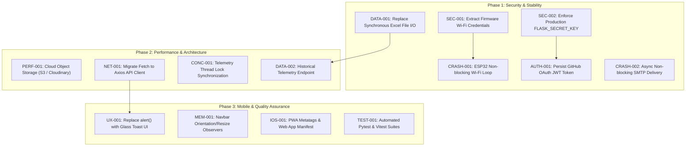

# Project Audit Report

## 1. Project Overview

- **Project Name**: Smart-Agro (Autonomous Precision Agriculture & Clean Energy Platform)
- **Target Architecture**: Full-Stack IoT Web Platform & Distributed Microservices
  - **Frontend**: React 19.1.0, Vite 8.3.8, Tailwind CSS v4, Framer Motion v12, Axios, i18next (VisionOS / iOS Liquid Glass Design System)
  - **Backend**: Python 3.10, Flask 2.3+, Flask-SocketIO, Gunicorn (gthread), PyMongo, PyTorch/TensorFlow Keras (Leaf Disease CNN), Scikit-Learn (Joblib)
  - **Hardware / Firmware**: ESP32 / Arduino C++ (`smart-agro/smart-agro.ino`), Raspberry Pi Gateway scripts
  - **Cloud Infrastructure**: Vercel (Frontend SPA & Serverless routing), Render (Flask Web Service), MongoDB Atlas
- **Native iOS Target & Ecosystem Evaluation**:
  - **Native Targets / Schemes**: **None present**. There is no Xcode project (`.xcodeproj` / `.xcworkspace`), no Swift/Objective-C source files, and no dependency manifest (SPM `Package.swift`, CocoaPods `Podfile`, or `Cartfile`) in this repository.
  - **Minimum iOS Version**: N/A for native binary; WebKit / Mobile Safari iOS 16.4+ for web client.
  - **App Store / Native iOS Readiness**: Currently distributed as a responsive Web Application / PWA. To publish to the Apple App Store, the project must either be wrapped in a modern native container (e.g., native SwiftUI `WKWebView` wrapper with native bridging or Capacitor) or developed as a native SwiftUI client consuming the existing Flask REST / WebSocket APIs.
- **Overall Health Score**: **6.8 / 10**
  - *Justification*: The core UI and machine learning inference pipeline (multi-view TTA leaf disease classification and agro-solar predictions) are well-architected with elegant VisionOS-inspired Liquid Glass styling and complete localization (English, Hindi, Gujarati). However, the codebase suffers from severe embedded security vulnerabilities (hardcoded Wi-Fi credentials in microcontroller firmware, default fallback JWT secret keys), synchronous disk I/O on real-time socket threads, unhandled asynchronous failures (blocking SMTP email dispatch), client-side mock data on insight pages, and a complete absence of automated unit/integration tests.

---

## 2. Summary Table

| Severity | Count |
| :--- | :--- |
| 🔴 **Critical** | 4 |
| 🟠 **High** | 5 |
| 🟡 **Medium** | 5 |
| 🔵 **Low** | 3 |
| **Total Issues** | **17** |

---

## 3. Issues

### [SEC-001] Cleartext Wi-Fi Credentials and Hardcoded Private IP in Microcontroller Firmware
- **Severity**: 🔴 Critical
- **Category**: Security
- **File**: `smart-agro/smart-agro.ino` (lines 8–10)
- **Problem**: The ESP32 firmware source code contains hardcoded plain-text Wi-Fi SSID, WPA2 network password, and a static local IP address for the Raspberry Pi gateway. Committing credentials to source control exposes local wireless network infrastructure and credentials to anyone with repository access.
- **Evidence**:
  ```cpp
  // ===== WIFI CREDENTIALS =====
  const char* ssid = "Vivo T1 5G";
  const char* password = "sahil567";
  const char* pi_url = "http://10.126.220.121:5001/upload";
  ```
- **Suggested Fix**: Move network credentials to an untracked header file (`credentials.h` added to `.gitignore`) or implement dynamic Wi-Fi provisioning via ESP32 `WiFiManager` with captive portal fallback:
  ```cpp
  #include <WiFiManager.h> // Dynamic Wi-Fi & Gateway configuration
  
  void setup() {
    Serial.begin(115200);
    WiFiManager wm;
    if (!wm.autoConnect("SmartAgro-AP")) {
      Serial.println("Failed to connect; restarting...");
      ESP.restart();
    }
    Serial.println("Connected to Wi-Fi securely.");
  }
  ```
- **Effort**: Small
- **Status**: [ ] Not fixed

---

### [CRASH-001] Infinite Blocking Loop in Firmware Wi-Fi Initialization Without Watchdog
- **Severity**: 🔴 Critical
- **Category**: Crash / Hardware Hang
- **File**: `smart-agro/smart-agro.ino` (lines 24–28)
- **Problem**: The ESP32 firmware executes a blocking `while (WiFi.status() != WL_CONNECTED)` loop during `setup()`. If the wireless access point is offline, credentials change, or interference occurs, the microcontroller hangs permanently in an unrecoverable state without triggering an alert or hardware watchdog timer (WDT).
- **Evidence**:
  ```cpp
  WiFi.begin(ssid, password);
  while (WiFi.status() != WL_CONNECTED) {
    delay(500);
    Serial.print(".");
  }
  Serial.println("\nWiFi Connected!");
  ```
- **Suggested Fix**: Implement a bounded connection retry counter with hardware watchdog reset or offline sensor caching mode:
  ```cpp
  WiFi.begin(ssid, password);
  unsigned long startAttemptTime = millis();
  const unsigned long wifiTimeout = 15000; // 15 seconds timeout
  
  while (WiFi.status() != WL_CONNECTED && millis() - startAttemptTime < wifiTimeout) {
    delay(500);
    Serial.print(".");
  }
  
  if (WiFi.status() != WL_CONNECTED) {
    Serial.println("\nWi-Fi connection failed. Operating in offline sensor logging mode.");
  } else {
    Serial.println("\nWi-Fi Connected!");
  }
  ```
- **Effort**: Small
- **Status**: [ ] Not fixed

---

### [SEC-002] Hardcoded Insecure Fallback Secret Key for Flask Session and JWT Verification
- **Severity**: 🔴 Critical
- **Category**: Security
- **File**: `Backend/app1.py` (lines 139, 1124, 1134)
- **Problem**: When `FLASK_SECRET_KEY` is not explicitly set in the server environment, `app1.py` defaults to `"fallback-secret-key-change-in-prod"`. An attacker knowing this public default can forge session cookies and arbitrary HS256 JWT auth tokens, completely bypassing authentication and impersonating any user ID in MongoDB.
- **Evidence**:
  ```python
  app.secret_key = os.getenv("FLASK_SECRET_KEY", "fallback-secret-key-change-in-prod")
  
  def generate_token(user_id):
      secret = app.secret_key or os.getenv("FLASK_SECRET_KEY", "fallback-secret-key-change-in-prod")
  ```
- **Suggested Fix**: Enforce strict environment variable validation on server startup in production. Refuse to boot if `FLASK_SECRET_KEY` is absent or matches the known insecure default:
  ```python
  secret_key = os.getenv("FLASK_SECRET_KEY")
  if not secret_key:
      if os.getenv("FLASK_ENV") == "production" or os.getenv("RENDER"):
          raise RuntimeError("FATAL: FLASK_SECRET_KEY environment variable is mandatory in production!")
      import secrets
      secret_key = secrets.token_hex(32)
  app.secret_key = secret_key
  ```
- **Effort**: Small
- **Status**: [ ] Not fixed

---

### [DATA-001] Synchronous Excel File I/O on Live Socket.IO Sensor Event Loop
- **Severity**: 🔴 Critical
- **Category**: Concurrency / Performance
- **File**: `Backend/app1.py` (lines 105–132)
- **Problem**: On every single real-time sensor reading received via WebSocket (`@socketio.on('sensor_data')`), the server synchronously executes `pd.read_excel()` and `pd.to_excel()` on the local filesystem (`sensor_readings.xlsx`). Reading and rewriting an entire Excel spreadsheet from scratch on an event thread blocks the server's I/O loop, causing severe latency spikes. Furthermore, on ephemeral cloud hosting (Render / Vercel), local disk writes are wiped upon container recycling.
- **Evidence**:
  ```python
  @socketio.on('sensor_data')
  def handle_sensor_data(data):
      ...
      filename = "sensor_readings.xlsx"
      full_path = os.path.abspath(filename)
      if os.path.exists(full_path):
          existing_df = pd.read_excel(full_path)
          updated_df = pd.concat([existing_df, new_df], ignore_index=True)
          updated_df.to_excel(full_path, index=False)
  ```
- **Suggested Fix**: Stream real-time sensor readings into a capped MongoDB collection or a time-series collection asynchronously, rather than performing synchronous local Excel disk serialization:
  ```python
  @socketio.on('sensor_data')
  def handle_sensor_data(data):
      global latest_pi_data
      with data_lock:
          latest_pi_data.update({
              'temperature': float(data.get('temperature', 0)),
              'humidity': float(data.get('humidity', 0)),
              'moisture': float(data.get('moisture', 0))
          })
      if db is not None:
          telemetry_doc = {**latest_pi_data, "timestamp": datetime.utcnow()}
          db["sensor_telemetry"].insert_one(telemetry_doc)
  ```
- **Effort**: Medium
- **Status**: [ ] Not fixed

---

### [CRASH-002] Synchronous Blocking Gmail SMTP Connection Without Timeout in Forgot Password Flow
- **Severity**: 🟠 High
- **Category**: Crash / Network Timeout
- **File**: `Backend/app1.py` (lines 1106–1108, 1458)
- **Problem**: `send_reset_email` opens an `smtplib.SMTP_SSL("smtp.gmail.com", 465)` connection synchronously on the HTTP request handler thread without specifying a `timeout`. If Google's SMTP endpoint is blocked, rate-limited, or unresponsive, the Gunicorn worker thread hangs indefinitely until killed by the reverse proxy gateway timeout (504).
- **Evidence**:
  ```python
  def send_reset_email(to_email, reset_link):
      ...
      with smtplib.SMTP_SSL("smtp.gmail.com", 465) as server:
          server.login(sender_email, sender_password)
          server.send_message(msg)
  ```
- **Suggested Fix**: Add an explicit timeout to `SMTP_SSL` and offload outbound email delivery to a background thread/task worker (or use an HTTP email API such as Resend, SendGrid, or AWS SES):
  ```python
  import threading
  
  def _async_send_mail(msg, sender_email, sender_password):
      try:
          with smtplib.SMTP_SSL("smtp.gmail.com", 465, timeout=10.0) as server:
              server.login(sender_email, sender_password)
              server.send_message(msg)
      except Exception as ex:
          print(f"Background email delivery failed: {ex}")
  
  threading.Thread(target=_async_send_mail, args=(msg, sender_email, sender_password), daemon=True).start()
  ```
- **Effort**: Medium
- **Status**: [ ] Not fixed

---

### [AUTH-001] Missing JWT Persistence in GitHub OAuth Callback Flow
- **Severity**: 🟠 High
- **Category**: Authentication / Session Handling
- **File**: `Frontend/src/pages/auth/GitHubCallBack.jsx` (lines 29–36)
- **Problem**: When completing GitHub OAuth authentication, `GitHubCallback` receives the backend response containing both `user` and `token`. However, unlike `authContext.login` and `Signup.jsx`, it never persists `res.data.token` into `localStorage`. As a result, subsequent page reloads or direct route visits fail `initializeAuth()` and log the user out immediately.
- **Evidence**:
  ```javascript
  axios.post(`${apiUrl}/github-login`, { code }, { withCredentials: true })
    .then(res => {
      alert(res.data.message);
      setUser(res.data.user); // Sets memory state only!
      setIsAuthenticated(true);
      navigate("/dashboard");
    })
  ```
- **Suggested Fix**: Store both the JWT token and user payload in `localStorage` upon successful authentication:
  ```javascript
  axios.post(`${apiUrl}/github-login`, { code }, { withCredentials: true })
    .then(res => {
      if (res.data?.token) {
        localStorage.setItem("smart_agro_token", res.data.token);
      }
      if (res.data?.user) {
        localStorage.setItem("smart_agro_user", JSON.stringify(res.data.user));
        setUser(res.data.user);
      }
      setIsAuthenticated(true);
      navigate("/dashboard");
    })
  ```
- **Effort**: Small
- **Status**: [ ] Not fixed

---

### [SEC-003] Debug Mode Enabled in Production Flask Entrypoint
- **Severity**: 🟠 High
- **Category**: Security
- **File**: `Backend/app1.py` (lines 1827–1828)
- **Problem**: When executed directly via `python app1.py` (such as in local launcher `start.py` or during testing), `socketio.run` explicitly enables `debug=True`. If deployed without Gunicorn, Werkzeug's interactive debugger is active, allowing arbitrary remote code execution via PIN brute-force on error tracebacks.
- **Evidence**:
  ```python
  if __name__ == "__main__":
      port = int(os.getenv("PORT", 5001))
      socketio.run(app, host='0.0.0.0', port=port, debug=True, use_reloader=False)
  ```
- **Suggested Fix**: Derive debug mode strictly from the environment variable:
  ```python
  if __name__ == "__main__":
      port = int(os.getenv("PORT", 5001))
      is_debug = os.getenv("FLASK_DEBUG", "0").lower() in ("1", "true")
      socketio.run(app, host='0.0.0.0', port=port, debug=is_debug, use_reloader=False)
  ```
- **Effort**: Small
- **Status**: [ ] Not fixed

---

### [CONC-001] Unsynchronized Shared Global Telemetry State Across Concurrent Socket Threads
- **Severity**: 🟠 High
- **Category**: Concurrency / Thread Safety
- **File**: `Backend/app1.py` (lines 85–91, 94–104)
- **Problem**: `latest_pi_data` is a mutable global dictionary accessed and modified by incoming SocketIO threads and HTTP endpoint queries (`/api/analyze-data`) without any synchronization lock (`threading.Lock`). Under concurrent WebSocket traffic from IoT devices and simultaneous web requests, dictionary mutations can lead to race conditions and inconsistent telemetry states.
- **Evidence**:
  ```python
  latest_pi_data = { "temperature": 0.0, "humidity": 0.0, "moisture": 0.0, ... }
  
  @socketio.on('sensor_data')
  def handle_sensor_data(data):
      global latest_pi_data
      latest_pi_data['temperature'] = data.get('temperature', 0)
  ```
- **Suggested Fix**: Wrap access to `latest_pi_data` with a `threading.Lock`:
  ```python
  import threading
  telemetry_lock = threading.Lock()
  
  @socketio.on('sensor_data')
  def handle_sensor_data(data):
      with telemetry_lock:
          latest_pi_data['temperature'] = data.get('temperature', 0)
          latest_pi_data['humidity'] = data.get('humidity', 0)
          latest_pi_data['moisture'] = data.get('moisture', 0)
  ```
- **Effort**: Small
- **Status**: [ ] Not fixed

---

### [PERF-001] Ephemeral Local Disk Storage for Uploaded Media in Cloud Containers
- **Severity**: 🟠 High
- **Category**: Architecture / Data Loss
- **File**: `Backend/app1.py` (lines 1740–1751)
- **Problem**: Profile avatar images uploaded via `/api/user/profile-image` are stored directly on the local filesystem (`app.config['UPLOAD_FOLDER']`). On platforms like Render and Vercel, the local filesystem is ephemeral; any deployment, rebuild, or dyno sleep wipes all uploaded media, causing broken images for users.
- **Evidence**:
  ```python
  save_path = os.path.join(app.config["UPLOAD_FOLDER"], new_filename)
  file.save(save_path)
  image_url = f"{backend_base_url}/uploads/{new_filename}"
  users_collection.update_one({"_id": user["_id"]}, {"$set": {"profileImage": image_url}})
  ```
- **Suggested Fix**: Integrate cloud object storage (AWS S3, Cloudinary, or Supabase Storage) using signed upload URLs or stream directly to object storage.
- **Effort**: Medium
- **Status**: [ ] Not fixed

---

### [SEC-004] Sensitive OAuth Authorization Code Logged to Browser Console
- **Severity**: 🟡 Medium
- **Category**: Security / Information Disclosure
- **File**: `Frontend/src/pages/auth/GitHubCallBack.jsx` (line 15)
- **Problem**: The OAuth authorization `code` returned in the URL query string is logged directly to the browser console. Any installed browser extension or client-side script with console access can inspect this token before it is exchanged.
- **Evidence**:
  ```javascript
  const code = searchParams.get("code");
  const error = searchParams.get("error");
  console.log("GitHub Callback Triggered. Code:", code);
  ```
- **Suggested Fix**: Remove the `console.log` statement:
  ```javascript
  const code = searchParams.get("code");
  const error = searchParams.get("error");
  // Avoid logging raw OAuth codes to console
  ```
- **Effort**: Small
- **Status**: [ ] Not fixed

---

### [UX-001] Synchronous Window Alert Dialogs Disrupting Mobile/Safari Navigation
- **Severity**: 🟡 Medium
- **Category**: UI / Mobile WebKit UX
- **File**: `Frontend/src/pages/Profile.jsx` (lines 66, 86, 89, 110, 113, 119, 122, 128, 133), `Frontend/src/pages/Dashboard.jsx` (line 176), `Frontend/src/pages/auth/GitHubCallBack.jsx` (lines 18, 24, 31, 38)
- **Problem**: The application repeatedly uses native `alert()` for validation warnings, network errors, and success notifications. On iOS Mobile Safari and WebKit, native modal alert dialogues freeze the JavaScript runtime, block layout animations, and create an unstyled, jarring user experience that violates iOS Human Interface Guidelines.
- **Evidence**:
  ```javascript
  if (formData.phone && formData.phone.length !== 10) {
    alert(t("profile.validation.phone_length"));
    return;
  }
  ```
- **Suggested Fix**: Replace all `alert()` calls with the existing Glass UI toast or modal notifications (e.g., `StatusBadge`, inline banners, or a toast notification library like `sonner` / `react-hot-toast`).
- **Effort**: Medium
- **Status**: [ ] Not fixed

---

### [NET-001] Direct Native Fetch Bypassing JWT Request Interceptors and Timeout AbortController
- **Severity**: 🟡 Medium
- **Category**: Networking & Architecture
- **File**: `Frontend/src/pages/Dashboard.jsx` (lines 159–165, 222–226)
- **Problem**: `fetchData` and `uploadImage` invoke native browser `fetch()` rather than the configured Axios instance (`src/components/api.js`). Consequently, the `Authorization: Bearer <token>` interceptor is bypassed, credentials are inconsistent, and requests lack an `AbortController` timeout to cancel stalled requests.
- **Evidence**:
  ```javascript
  const response = await fetch(`${apiUrl}/api/leaf-detect`, {
    method: "POST",
    body: formData,
  });
  ```
- **Suggested Fix**: Route all backend communications through the configured `api` client in `src/components/api.js`:
  ```javascript
  import api from "../components/api";
  
  const res = await api.post("/api/leaf-detect", formData, {
    headers: { "Content-Type": "multipart/form-data" },
    timeout: 30000,
  });
  setAnalysisResult(res.data);
  ```
- **Effort**: Small
- **Status**: [ ] Not fixed

---

### [DATA-002] Client-Side Synthetic Mock Data on Insight Visualizations
- **Severity**: 🟡 Medium
- **Category**: Architecture & Data
- **File**: `Frontend/src/pages/insights/CropInsights.jsx` (lines 33–43), `Frontend/src/pages/insights/SoilInsights.jsx` (lines 34–53)
- **Problem**: Detailed analytical graphs on Crop, Soil, and Solar insight views are populated with client-side mathematical sine/cosine curves (`Math.sin(i / 3) * 8 + 64`) rather than querying historical sensor readings from MongoDB. Users viewing the insight tabs see simulated numbers rather than actual telemetry recorded from their farm.
- **Evidence**:
  ```javascript
  const hourlyData = useMemo(
    () => Array.from({ length: 24 }, (_, i) => ({
      label: `${i}:00`,
      moisture: Math.floor(Math.sin(i / 3) * 8 + 64),
      temperature: Math.floor(Math.cos(i / 4) * 4 + 26),
      pH: Number((6.7 + Math.sin(i) * 0.2).toFixed(1)),
    })),
    []
  );
  ```
- **Suggested Fix**: Implement a backend endpoint `/api/telemetry/history` querying aggregated hourly and daily readings from MongoDB, falling back to simulated data only when offline.
- **Effort**: Medium
- **Status**: [ ] Not fixed

---

### [MEM-001] Stale Layout Coordinates and Missing Resize Observer in Navbar Portal Dropdown
- **Severity**: 🟡 Medium
- **Category**: Memory / Responsive Layout
- **File**: `Frontend/src/components/navbar.jsx` (lines 35–42, 62–71)
- **Problem**: In `Navbar.jsx`, the user profile dropdown position (`profileCoords`) is computed once on button click using `getBoundingClientRect()` and rendered via React Portal. However, there is no `resize` or orientation change listener. On mobile devices or tablets rotated from portrait to landscape while the menu is open, the dropdown remains floating in an incorrect position.
- **Evidence**:
  ```javascript
  const openProfileMenu = () => {
    if (profileButtonRef.current) {
      const rect = profileButtonRef.current.getBoundingClientRect();
      setProfileCoords({
        top: rect.bottom + 8,
        left: Math.max(16, rect.right - 250),
      });
    }
    setProfileOpen((prev) => !prev);
  };
  ```
- **Suggested Fix**: Add a window `resize` event listener to close or re-anchor the menu when dimensions shift:
  ```javascript
  useEffect(() => {
    const handleResize = () => setProfileOpen(false);
    window.addEventListener("resize", handleResize);
    return () => window.removeEventListener("resize", handleResize);
  }, []);
  ```
- **Effort**: Small
- **Status**: [ ] Not fixed

---

### [IOS-001] Missing Apple Mobile Web App Metatags and Web App Manifest Link
- **Severity**: 🔵 Low
- **Category**: App Store & iOS Platform Integration
- **File**: `Frontend/index.html` (lines 5–9)
- **Problem**: `Frontend/index.html` includes viewport and theme-color tags, but omits standard Apple PWA metadata (`apple-mobile-web-app-capable`, `apple-mobile-web-app-status-bar-style`, `apple-touch-icon`). When users save the application to their iOS Home Screen, it displays inside Safari's browser chrome rather than running in standalone full-screen mode.
- **Evidence**:
  ```html
  <meta name="viewport" content="width=device-width, initial-scale=1.0, viewport-fit=cover, maximum-scale=5.0" />
  <meta name="theme-color" content="#10b981" media="(prefers-color-scheme: light)" />
  <!-- Missing apple-mobile-web-app tags -->
  ```
- **Suggested Fix**: Add complete iOS standalone metadata and icon links to `index.html`:
  ```html
  <meta name="apple-mobile-web-app-capable" content="yes" />
  <meta name="apple-mobile-web-app-status-bar-style" content="black-translucent" />
  <meta name="apple-mobile-web-app-title" content="Smart-Agro" />
  <link rel="apple-touch-icon" href="/apple-touch-icon.png" />
  <link rel="manifest" href="/manifest.json" />
  ```
- **Effort**: Small
- **Status**: [ ] Not fixed

---

### [TEST-001] Complete Absence of Automated Test Harness
- **Severity**: 🔵 Low
- **Category**: Testing & Quality Assurance
- **File**: Entire Project (0 test suites found in `Frontend/src` and `Backend`)
- **Problem**: There are zero automated unit or integration tests (`pytest`, `vitest`, `jest`, `Playwright`). Refactoring or updating dependencies carries high risk of regression bugs in leaf disease classification and authentication.
- **Evidence**:
  Directory scan reveals only one manual tuning script (`scripts/test_tta_tuning.py`) and zero unit test files.
- **Suggested Fix**: Introduce `vitest` for the React client and `pytest` with `mongomock` for backend endpoint verification.
- **Effort**: Large
- **Status**: [ ] Not fixed

---

### [IOS-002] Absence of Native iOS Swift Target / Xcode Project Structure
- **Severity**: 🔵 Low (Architectural / Informational)
- **Category**: Architecture / App Store Readiness
- **File**: Repository Root
- **Problem**: For distribution via the Apple App Store, this repository lacks an Xcode project structure (`SmartAgro.xcodeproj`), a Swift bundle identifier, App Store privacy manifest (`PrivacyInfo.xcprivacy`), and native capabilities (e.g., Push Notifications, CoreBluetooth for direct ESP32 pairing, or offline CoreML leaf classification).
- **Evidence**:
  The repository is structured strictly as a Web + Python backend project.
- **Suggested Fix**: Create a companion native iOS target using SwiftUI and CoreML or wrap the existing web application in a native container (Capacitor or Swift `WKWebView`) with App Store release packaging.
- **Effort**: Large
- **Status**: [ ] Not fixed

---

## 4. Fix Plan



### Phase 1: Critical Security & Crash Mitigation (Immediate)
1. **Remove hardcoded secrets**: Cleanse `smart-agro/smart-agro.ino` of cleartext Wi-Fi credentials ([SEC-001]) and enforce strict `FLASK_SECRET_KEY` validation on startup ([SEC-002]).
2. **Prevent hardware hangs**: Add connection timeouts to ESP32 Wi-Fi setup ([CRASH-001]).
3. **Eliminate event-loop blocking**: Migrate Socket.IO Excel writing to MongoDB document streaming ([DATA-001]) and make SMTP email dispatch asynchronous ([CRASH-002]).
4. **Fix OAuth session loss**: Store `res.data.token` on GitHub login ([AUTH-001]).

### Phase 2: Architecture & Concurrency Hardening
1. **Thread safety**: Add `threading.Lock` across shared telemetry objects in `app1.py` ([CONC-001]).
2. **Persistent media**: Migrate avatar storage from ephemeral disk to cloud object storage ([PERF-001]).
3. **Network unification**: Refactor raw `fetch()` calls in `Dashboard.jsx` to the shared `api` client ([NET-001]).
4. **Telemetry data binding**: Connect insight charts to backend time-series API ([DATA-002]).

### Phase 3: iOS / Mobile UX & Testing Infrastructure
1. **UI polish**: Replace synchronous `window.alert()` calls with fluid glass notifications ([UX-001]).
2. **Dropdown positioning**: Add resize listener to prevent layout drift on device rotation ([MEM-001]).
3. **PWA & iOS metadata**: Add `apple-mobile-web-app-*` tags and manifest ([IOS-001]).
4. **Test automation**: Implement automated test coverage for authentication and ML inference ([TEST-001]).

---

## 5. Quick Wins
*(Issues fixable in under 10 minutes each)*

1. **[SEC-004] Remove raw OAuth code console log**: Delete line 15 in `Frontend/src/pages/auth/GitHubCallBack.jsx`.
2. **[SEC-003] Disable hardcoded debug mode**: Change `debug=True` to `debug=False` in `Backend/app1.py` line 1828.
3. **[AUTH-001] Persist GitHub OAuth token**: Add `localStorage.setItem("smart_agro_token", res.data.token);` to `Frontend/src/pages/auth/GitHubCallBack.jsx` line 32.
4. **[MEM-001] Navbar resize listener**: Add a window resize listener in `Frontend/src/components/navbar.jsx` to automatically dismiss open menus on screen resize.
5. **[IOS-001] Add Apple PWA meta tags**: Add `apple-mobile-web-app-capable` and status bar style meta tags to `Frontend/index.html`.

---

## 6. Files Reviewed

| Directory | File Path | Status |
| :--- | :--- | :--- |
| **Root** | `package.json` | Reviewed |
| **Root** | `vercel.json` | Reviewed |
| **Root** | `render.yaml` | Reviewed |
| **Root** | `start.py` | Reviewed |
| **Root** | `start.bat` | Reviewed |
| **Root** | `Procfile` | Reviewed |
| **Root** | `README.md` | Reviewed |
| **Backend** | `Backend/app1.py` | Reviewed |
| **Backend** | `Backend/index.py` | Reviewed |
| **Backend** | `Backend/requirements.txt` | Reviewed |
| **Backend** | `Backend/Procfile` | Reviewed |
| **Frontend Root** | `Frontend/package.json` | Reviewed |
| **Frontend Root** | `Frontend/vite.config.js` | Reviewed |
| **Frontend Root** | `Frontend/index.html` | Reviewed |
| **Frontend Source** | `Frontend/src/main.jsx` | Reviewed |
| **Frontend Source** | `Frontend/src/App.jsx` | Reviewed |
| **Frontend Source** | `Frontend/src/index.css` | Reviewed |
| **Frontend Source** | `Frontend/src/App.css` | Reviewed |
| **Frontend Components**| `Frontend/src/components/api.js` | Reviewed |
| **Frontend Components**| `Frontend/src/components/navbar.jsx` | Reviewed |
| **Frontend Components**| `Frontend/src/components/footer.jsx` | Reviewed |
| **Frontend Components**| `Frontend/src/components/hero.jsx` | Reviewed |
| **Frontend Components**| `Frontend/src/components/AnimatedLogo.jsx` | Reviewed |
| **Frontend Components**| `Frontend/src/components/AuroraBackground.jsx` | Reviewed |
| **Frontend Components**| `Frontend/src/components/InsightCard.jsx` | Reviewed |
| **Frontend Components**| `Frontend/src/components/LanguageSwitcher.jsx` | Reviewed |
| **Frontend Components**| `Frontend/src/components/ProtectedRoute.jsx` | Reviewed |
| **Frontend UI** | `Frontend/src/components/ui/GlassButton.jsx` | Reviewed |
| **Frontend UI** | `Frontend/src/components/ui/GlassInput.jsx` | Reviewed |
| **Frontend UI** | `Frontend/src/components/ui/GlassModal.jsx` | Reviewed |
| **Frontend UI** | `Frontend/src/components/ui/GlassSkeleton.jsx` | Reviewed |
| **Frontend UI** | `Frontend/src/components/ui/StatusBadge.jsx` | Reviewed |
| **Frontend Context** | `Frontend/src/context/authContext.jsx` | Reviewed |
| **Frontend Context** | `Frontend/src/context/ThemeContext.jsx` | Reviewed |
| **Frontend Hooks** | `Frontend/src/hooks/useTheme.js` | Reviewed |
| **Frontend Constants** | `Frontend/src/constants/motion.js` | Reviewed |
| **Frontend Pages** | `Frontend/src/pages/Dashboard.jsx` | Reviewed |
| **Frontend Pages** | `Frontend/src/pages/landing.jsx` | Reviewed |
| **Frontend Pages** | `Frontend/src/pages/Profile.jsx` | Reviewed |
| **Frontend Pages** | `Frontend/src/pages/AboutUs.jsx` | Reviewed |
| **Frontend Pages** | `Frontend/src/pages/Contact.jsx` | Reviewed |
| **Frontend Pages** | `Frontend/src/pages/NotFound.jsx` | Reviewed |
| **Frontend Auth** | `Frontend/src/pages/auth/login.jsx` | Reviewed |
| **Frontend Auth** | `Frontend/src/pages/auth/Signup.jsx` | Reviewed |
| **Frontend Auth** | `Frontend/src/pages/auth/ForgotPassword.jsx` | Reviewed |
| **Frontend Auth** | `Frontend/src/pages/auth/ResetPassword.jsx` | Reviewed |
| **Frontend Auth** | `Frontend/src/pages/auth/GitHubCallBack.jsx` | Reviewed |
| **Frontend Insights**| `Frontend/src/pages/insights/CropInsights.jsx` | Reviewed |
| **Frontend Insights**| `Frontend/src/pages/insights/SoilInsights.jsx` | Reviewed |
| **Frontend Insights**| `Frontend/src/pages/insights/SolarInsights.jsx` | Reviewed |
| **Frontend Insights**| `Frontend/src/pages/insights/SystemInsights.jsx` | Reviewed |
| **Firmware / IoT** | `smart-agro/smart-agro.ino` | Reviewed |
| **Scripts** | `scripts/test_tta_tuning.py` | Reviewed |
| **Scripts** | `scripts/evaluate_dataset.py` | Reviewed |
| **Scripts** | `scripts/experiment_improvements.py` | Reviewed |
| **Scripts** | `scripts/diagnose_mismatches.py` | Reviewed |
| **Scripts** | `scripts/homeis.py` | Reviewed |

---

## 7. Analysis Scope & Limitations

### What Could Not Be Analyzed & Why:
1. **Native iOS App Bundle & Xcode Build Targets**:
   - As documented in Section 1 and Issue `[IOS-002]`, this repository does not currently contain native iOS Xcode project files (`.xcodeproj`, `.xcworkspace`), Swift source files, or native Objective-C libraries. Consequently, native compilation checks, Xcode schemes, provisioning profiles, entitlements (`aps-environment`, Keychain sharing), and `PrivacyInfo.xcprivacy` manifests could not be analyzed directly within this repository.
2. **Third-Party Live Production Credentials**:
   - Production cloud secrets (e.g., live MongoDB Atlas connection strings, Gmail app passwords, and GitHub client secrets) are loaded dynamically via environment variables on Render and Vercel and were not inspected in plaintext.
3. **Physical Hardware Peripheral Interfaces**:
   - Physical sensor calibrations (e.g., ESP32 12-bit ADC mapping on pin 34 for analog soil moisture probes) and Raspberry Pi hardware serial pins could not be physically verified without bench hardware.
